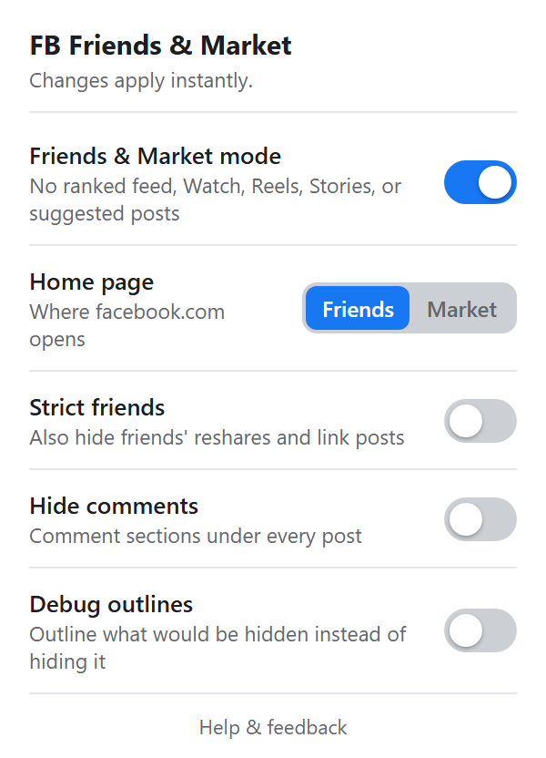
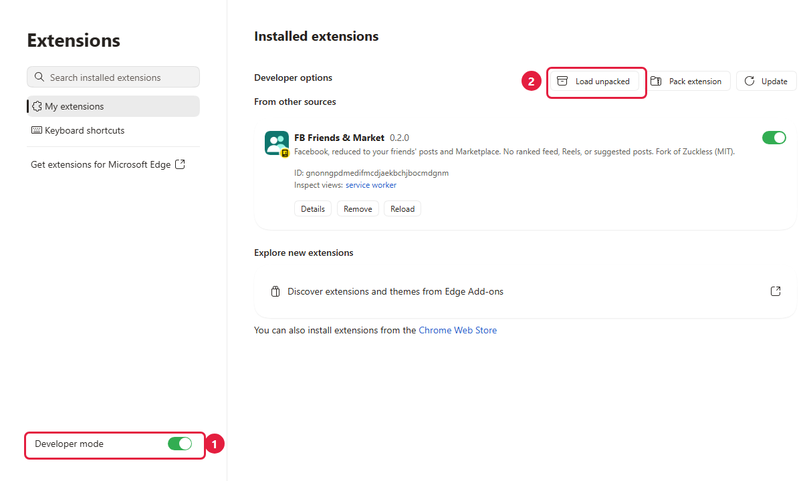

# FB Friends & Market

**Facebook, without the junk.**

A free add-on for Microsoft Edge and Google Chrome. It shows you what your friends post and Facebook Marketplace, and nothing else. There are no "Suggested for you" posts, no ads in your feed, no Reels, and none of the posts designed to make you angry.

**What it does:**

- Opens Facebook on your **Friends feed**: only your friends' posts, newest first.
- Hides **ads, suggested posts, Reels, Stories, and "People you may know."**
- Removes the **Video, Gaming, and Memories** shortcuts.
- Adds a small **Friends | Marketplace** button in the bottom-left corner, so you can switch between the two.
- Leaves **Messenger, notifications, friends' profiles, groups, and Marketplace** working normally.

> **This is an early version.** Facebook changes its website often, so now and then something may slip through, or something may disappear that shouldn't. If you notice that, please [let us know](https://github.com/Maulth/fb-friends-market/issues).

 

## How to install

This takes about two minutes, and you only do it once.

### Step 1: Download it

**[⬇ Download FB Friends & Market](https://github.com/Maulth/fb-friends-market/releases/latest/download/fb-friends-market.zip)**

This downloads a small file called `fb-friends-market.zip`.

### Step 2: Unzip it somewhere you'll keep it

- **Windows:** Open your Downloads folder, right-click `fb-friends-market.zip`, and choose **Extract All…**. In the window that opens, click **Browse**, choose your **Documents** folder, and click **Extract**.
- **Mac:** Double-click the zip in your Downloads folder. Then drag the new `fb-friends-market` folder into **Documents**.

You now have a folder called `fb-friends-market`. **Keep it where it is.** Your browser runs the add-on from this folder, so if you delete or move it, the add-on stops working.

### Step 3: Add it to your browser

<b>Microsoft Edge</b>

1. Click in the address bar at the top of Edge, type `edge://extensions`, and press **Enter**.
2. Turn on **Developer mode** (marked **1** below). It's at the bottom left. If you don't see it, make the window wider or click the **☰** menu at the top left.
3. Click **Load unpacked** (marked **2**). It appears at the top once Developer mode is on.
4. Choose the `fb-friends-market` folder from Step 2, and click **Select Folder**.

<b>Google Chrome</b>

1. Click in the address bar at the top of Chrome, type `chrome://extensions`, and press **Enter**.
2. Turn on **Developer mode**, using the switch at the top right.
3. Click **Load unpacked**, at the top left.
4. Choose the `fb-friends-market` folder from Step 2, and click **Select Folder** (on a Mac, **Select**).

FB Friends & Market now shows up in your list of extensions.

### Step 4: Pin it to your toolbar (optional)

Click the **puzzle-piece icon** next to the address bar and find **FB Friends & Market**. In Edge, click the **eye icon** next to it. In Chrome, click the **pin**. Its icon now sits next to the address bar, and one click opens its settings.

### Step 5: Open Facebook

Go to [facebook.com](https://www.facebook.com). You should land on your Friends feed, with the **Friends | Marketplace** button in the bottom-left corner. You're done.

## Settings

Click the add-on's icon (two people on a green square) to open its settings. Changes happen right away, so there's no need to reload the page.

| Setting | What it does |
|---|---|
| **Friends & Market mode** | The main on/off switch. Turn it off to see normal Facebook again. |
| **Home page** | Choose whether Facebook opens on your **Friends** feed or on **Marketplace**. |
| **Strict friends** | Also hides posts where a friend shares someone else's post or a news link, leaving only things your friends wrote or photographed themselves. |
| **Hide comments** | Hides the comment sections under posts. This works even with the main switch off. |
| **Debug outlines** | Instead of hiding things, it draws a red box around them and says why. This is useful when you're reporting a problem. |

## Updating to a new version

1. Download the zip again, from the same link as Step 1.
2. Unzip it into the same place as before, replacing the old copy:
   - **Windows:** Right-click the zip, choose **Extract All…**, click **Browse**, pick **Documents** again, and click **Extract**. When Windows asks, choose **Replace the files in the destination**.
   - **Mac:** Double-click the zip and drag the new `fb-friends-market` folder into **Documents**. When asked, choose **Replace**.
3. Go back to `edge://extensions` (or `chrome://extensions`) and click **Reload** on FB Friends & Market.

Your settings stay the same, as long as you keep using the same folder.

## Removing it

Go to `edge://extensions` (or `chrome://extensions`) and click **Remove** on FB Friends & Market. Then you can delete the `fb-friends-market` folder.

## Questions

**Is it safe?**
Everything runs on your own computer. The add-on doesn't collect, save, or send anything anywhere: there are no accounts, no tracking, and no analytics. It can only see facebook.com, and it only stores your settings, which your browser keeps. All of the code is published here, so anyone can read it.

**Why do I have to turn on "Developer mode"?**
That's how Edge and Chrome let you add an extension that isn't from their store. It doesn't change anything else about your browser. Now and then your browser may remind you that you have a developer-mode extension installed. That's normal; choose to keep it.

**I got an error: "Manifest file is missing or unreadable."**
You picked the wrong folder. Choose the `fb-friends-market` folder that has the file `manifest.json` directly inside it, not a folder that contains it.

**A friend's post disappeared, or junk is still getting through.**
Turn on **Debug outlines**, take a screenshot, and [report it here](https://github.com/Maulth/fb-friends-market/issues/new). Please blur out names and photos before you post the screenshot.

**I just want normal Facebook for a minute.**
Click the add-on's icon and turn off **Friends & Market mode**. Turn it back on whenever you like.

**Does it work on my phone, or in Firefox or Safari?**
Not yet. It works in Microsoft Edge and Google Chrome on Windows and Mac computers. Phone apps can't run add-ons at all.

**Does it work if my Facebook isn't in English?**
Partly. Opening on the Friends feed and blocking Reels and Video work in any language. Filtering out ads and suggested posts only works when Facebook is set to English, for now.

## Credits

Built on [Zuckless](https://github.com/scottylad007/zuckless) by Scott Lombard, under the MIT license (see [LICENSE](LICENSE)). It isn't affiliated with or endorsed by Facebook or Meta.

**Developers:** see [DEVELOPMENT.md](DEVELOPMENT.md).
